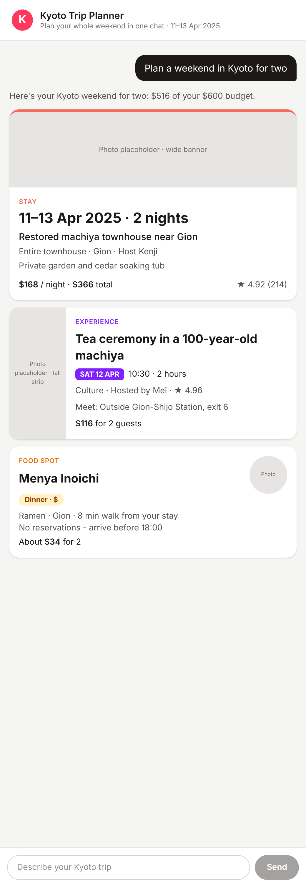
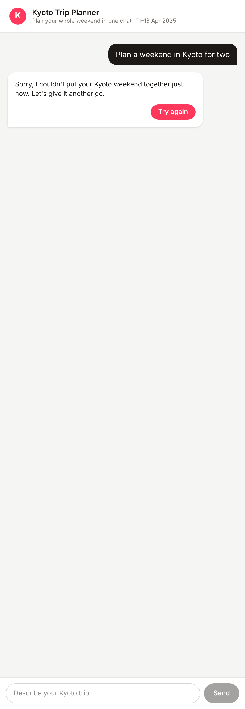

# Kyoto Trip Planner — chat prototype

A clickable prototype for Airbnb's Kyoto trip-planner chat, built for Thursday's guest test.
A guest types one Kyoto trip request, a thinking animation plays, and three itinerary cards appear: **Stay**, **Experience** and **Food spot**. No login needed.



## What it does

1. **Chat page:** a header, a scrolling thread and a text box with a Send button.
2. **Locks while thinking:** after you press Send, the text box and button lock and three pulsing dots show in the reply bubble before any cards appear.
3. **Mock reply from the workbook:** three rows from `kyoto_weekend_content.xlsx` (see `lib/mockResponse.ts`):
   | Card | Row | Pick | Cost for 2 |
   |---|---|---|---|
   | Stay | S1 | Restored machiya townhouse near Gion, 11–13 Apr 2025 | $366 |
   | Experience | E1 | Tea ceremony in a 100-year-old machiya, Sat 12 Apr 10:30 | $116 |
   | Food | F1 | Menya Inoichi (ramen, Gion, 8 min walk) | $34 |
   | **Total** | | | **$516 of $600 budget** |

   Skipped on purpose: E3 (sold out), E4 (no host listed), F4 (pushes the weekend over budget).
   Photos are grey placeholders because image rights for the prototype are not cleared.
4. **Three separate cards, each with its own layout** (one component each in `components/`):
   | Card | Image box | Biggest text | Accent |
   |---|---|---|---|
   | Stay | Wide banner, top | Travel dates | Coral top border |
   | Experience | Tall strip, left | Activity name | Purple day label |
   | Food spot | Round thumbnail, top right | Restaurant name | Amber meal/price label |
5. **Never a blank chat:** if the reply comes back empty or broken, the guest sees a friendly error bubble with **Try again**, which brings the three cards back.

## Try the error state

Add `?fail=once` to the address. The first request returns an empty reply, so the error bubble appears. Tap **Try again** and the three cards appear.

| Thinking | Error | Cards after Try again |
|---|---|---|
|  |  |  |

## Run it locally

```bash
npm install
npm run dev
```
Then open http://localhost:3000.

## Built with

TypeScript · Next.js (App Router) · React 19 · Tailwind CSS · built with Claude Code.
