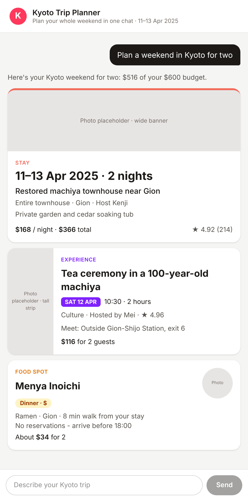

# Kyoto Trip Planner — chat prototype

A clickable prototype for Airbnb's Kyoto trip-planner chat, built for Thursday's guest test.
A guest types one Kyoto trip request, a thinking animation plays, and three itinerary cards appear: **Stay**, **Experience** and **Food spot**. No login needed.


## What it does

1. **Chat page:** a header, a scrolling thread and a text box with a Send button.
2. **Locks while thinking:** after you press Send, the text box and button lock and three pulsing dots show in the reply bubble before any cards appear. While the dots are going, the box is greyed out and reads "Planning your trip…", so a second request can't be sent: pressing Enter or Send does nothing. When the cards arrive, the box unlocks.
3. **Mock reply from the workbook:** three rows from `kyoto_weekend_content.xlsx` (see `lib/mockResponse.ts`):
   | Card | Row | Pick | Cost for 2 |
   |---|---|---|---|
   | Stay | S1 | Restored machiya townhouse near Gion, 11–13 Apr 2025 | $366 |
   | Experience | E1 | Tea ceremony in a 100-year-old machiya, Sat 12 Apr 10:30 | $116 |
   | Food | F1 | Menya Inoichi (ramen, Gion, 8 min walk) | $34 |
   | **Total** | | | **$516 of $600 budget** |

   Skipped on purpose: E3 (sold out), E4 (no host listed), F4 (pushes the weekend over budget).
   Photos are grey placeholders because image rights for the prototype are not cleared.
4. **Three separate cards, each with its own layout** (one component each in `components/`):
   | Card | Image box | Biggest text | Accent |
   |---|---|---|---|
   | Stay | Wide banner, top | Travel dates | Coral top border |
   | Experience | Tall strip, left | Activity name | Purple day label |
   | Food spot | Round thumbnail, top right | Restaurant name | Amber meal/price label |
5. **Never a blank chat:** if the reply comes back empty or broken, the guest sees a friendly error bubble with **Try again**, which brings the three cards back.

## Try the error state

Add `?fail=once` to the address (e.g. `http://localhost:3000/?fail=once`) and send "Plan a weekend in Kyoto for two".

**Step 1: Send.** The box locks and the thinking dots play.


**Step 2: The first reply fails on purpose.** It comes back empty, so the thinking bubble turns into a friendly message bubble: *"I couldn't put your Kyoto weekend together. Tap Try again and I'll plan it again."* with one **Try again** button inside it. The thread is never blank.

The bubble follows the Airbnb *Assistant Bubble Error Message Guidelines*:
- **Wording:** a 7-word lead line in the guest's terms, one sentence saying what happens next, no blame, no exclamation marks, and none of the banned words (error, failed, invalid, status codes…).
- **Button:** exactly one, "Try again" in sentence case, inside the bubble directly below the message, using the chat's primary button style. No pop-ups or alerts.
- **Look:** same shape and left alignment as a normal assistant reply, white with a thin grey border, dark grey text, no red anywhere.
- **Accessibility:** `aria-live="polite"` on the reply container (it's on the page from the thinking dots onward), a visible keyboard focus ring, and a 44px-tall button.


**Step 3: Tap Try again.** The same request is sent again, the dots play, and the Stay, Experience and Food cards appear.



Checked by running it in a browser at `/?fail=once`:

| Moment | Error bubble | Try again button | Cards | Box locked |
|---|---|---|---|---|
| After the first Send | Yes | Yes | 0 | No |
| Just after tapping Try again | No | No | 0 | Yes (dots playing) |
| When the retry finishes | No | No | 3 | No |

## Run it locally

```bash
npm install
npm run dev
```
Then open http://localhost:3000.

## Built with

TypeScript · Next.js (App Router) · React 19 · Tailwind CSS · built with Claude Code.
