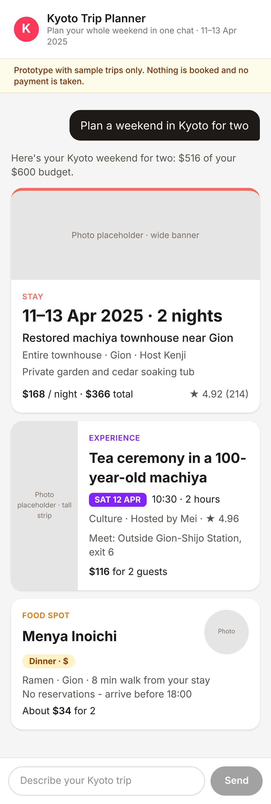
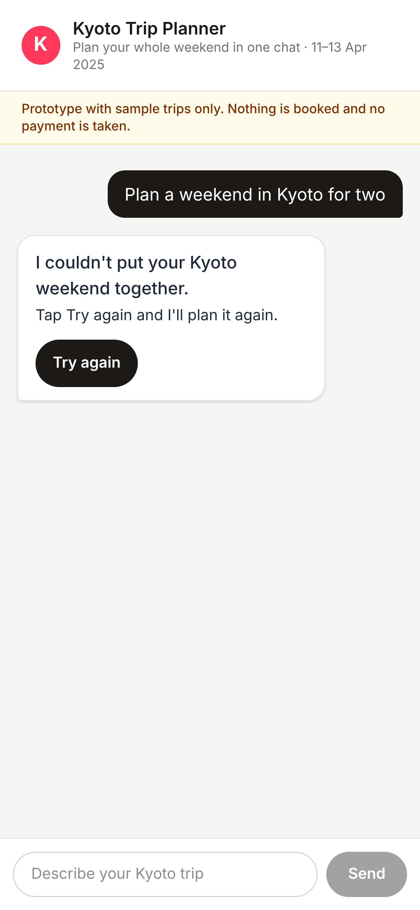
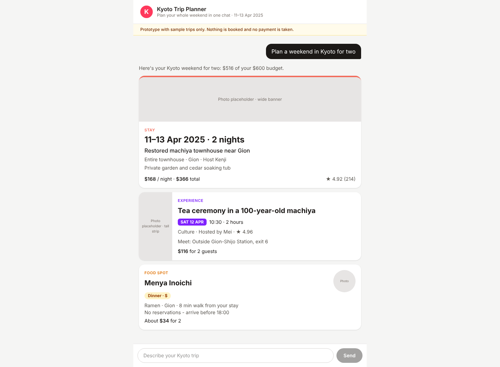
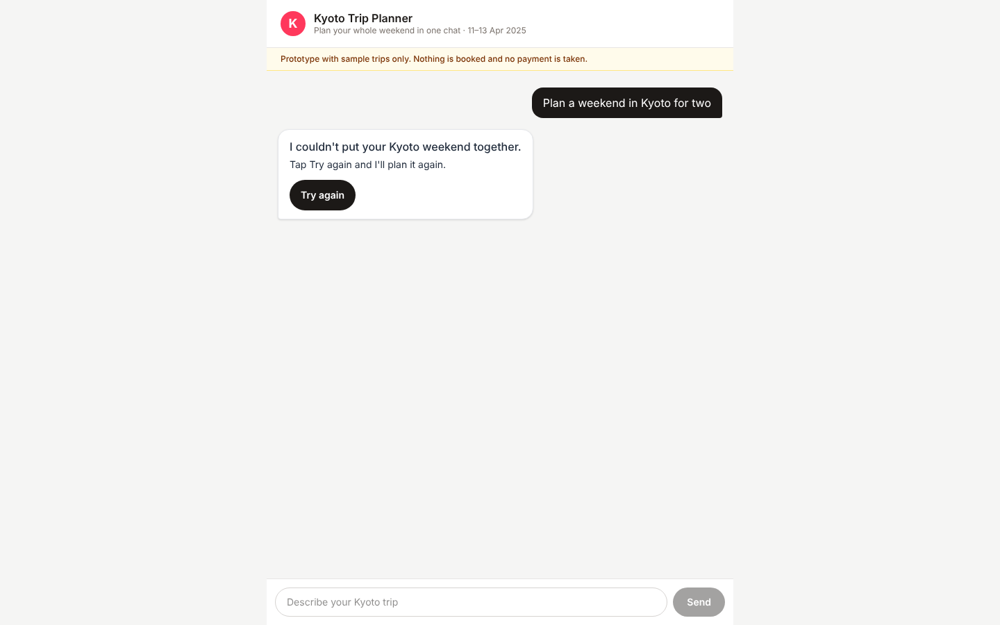
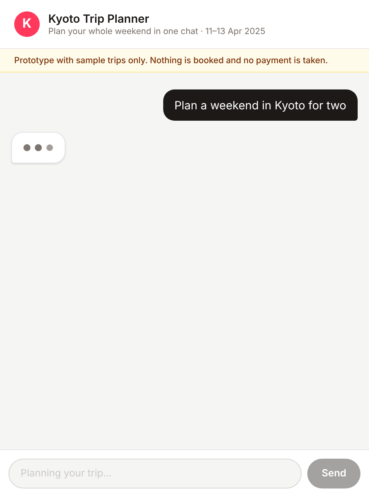

**Live prototype: https://kyoto-trip-planner-ashen.vercel.app/**
**Try the failure path: https://kyoto-trip-planner-ashen.vercel.app/?fail=once**

# Kyoto Trip Planner: chat prototype

A clickable prototype of Airbnb's Kyoto trip-planner chat, built for the moderated guest sessions. A guest types one Kyoto trip request, a thinking animation plays, and three itinerary cards appear: **Stay**, **Experience** and **Food spot**. There's no login, no install and no setup.

## Message for the team (#search-trip-planner)

> Hi Hannah, Tomás, Priya and Daniel, the Kyoto trip-planner prototype is live for Thursday's dry run (13 March) and the guest sessions on 1 April: https://kyoto-trip-planner-ashen.vercel.app/
>
> **Happy path:** type "Plan a weekend in Kyoto for two" and press Send. You'll see thinking dots, then the Stay, Experience and Food cards.
>
> **Failure path:** open https://kyoto-trip-planner-ashen.vercel.app/?fail=once and send the same request. A friendly message with Try again appears, and Try again brings the three cards back. No code edits needed.
>
> No login or install. Sample trips only, so nothing is booked.

## Session checklist

Checked against *Moderated Session Prototype Requirements: Trip-Planner Chat*, on the production link, in a fresh private window with nothing logged in.

| Check | Phone (390px, private window) | Laptop (1440px, incognito) |
|---|---|---|
| Opens with no install, no login and no configuration | ✅ | ✅ |
| One typed request shows a thinking state first | ✅ | ✅ |
| **3 of 3 cards** appear: Stay, Experience, Food | ✅ | ✅ |
| The three cards look clearly different (own layout each, not swapped text) | ✅ | ✅ |
| Nothing cut off, no sideways scrolling at phone width | ✅ | ✅ |
| Forced failure shows a friendly message and Try again **inside** the assistant bubble | ✅ | ✅ |
| **0 blank-chat moments**: at the failure, when Try again is pressed (thinking dots show) and after it | ✅ | ✅ |
| Try again brings the three cards back | ✅ | ✅ |
| **Mocked data note** visible: "Prototype with sample trips only. Nothing is booked and no payment is taken." | ✅ | ✅ |
| Shared link is the production `*.vercel.app` domain, not a protected preview link | ✅ | ✅ |

### Phone (390px)

| Three cards | Failure with Try again | Cards after Try again |
|---|---|---|
|  |  |  |

### Laptop (1440px)





## How to fire the failure

Add `?fail=once` to the end of the link, then send "Plan a weekend in Kyoto for two". The first reply comes back empty on purpose, so the chat shows the friendly message with **Try again**. Every request after that works normally, so Try again brings the three cards back. Nothing in the code needs to change.

## What's inside

- **Thinking state:** after Send, the text box and button lock ("Planning your trip…") and three pulsing dots show in the reply bubble. A second request can't be sent until the cards arrive.

  

- **Mock reply from the workbook:** three rows from `kyoto_weekend_content.xlsx` (see `lib/mockResponse.ts`):

  | Card | Row | Pick | Cost for 2 |
  |---|---|---|---|
  | Stay | S1 | Restored machiya townhouse near Gion, 11–13 Apr 2025 | $366 |
  | Experience | E1 | Tea ceremony in a 100-year-old machiya, Sat 12 Apr 10:30 | $116 |
  | Food | F1 | Menya Inoichi (ramen, Gion, 8 min walk) | $34 |
  | **Total** | | | **$516 of $600 budget** |

  Skipped on purpose: E3 (sold out), E4 (no host listed), F4 (pushes the weekend over budget). Photos are grey placeholders because image rights for the prototype are not cleared.

- **Three separate card components** in `components/`, each with its own layout:

  | Card | Image box | Biggest text | Accent |
  |---|---|---|---|
  | Stay | Wide banner, top | Travel dates | Coral top border |
  | Experience | Tall strip, left | Activity name | Purple day label |
  | Food spot | Round thumbnail, top right | Restaurant name | Amber meal/price label |

- **Failure bubble** follows Airbnb's *Assistant Bubble Error Message Guidelines*: a 7-word lead line in the guest's terms ("I couldn't put your Kyoto weekend together.") plus one sentence saying what happens next. There's one sentence-case **Try again** button inside the bubble, it uses the same shape as a normal reply, it uses no red, the container has `aria-live="polite"`, it shows a keyboard focus ring, and the button is 44px tall.

## Run it locally

```bash
npm install
npm run dev
```
Then open http://localhost:3000 (or http://localhost:3000/?fail=once).

## Built with

TypeScript · Next.js (App Router) · React 19 · Tailwind CSS · deployed on Vercel · built with Claude Code.
